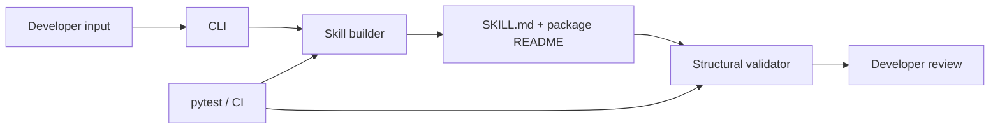

# Architecture

SkillForge is deliberately small in its first release. The core library has no runtime dependencies and can be called from Python or the CLI.

## Current scope

- `core.py` normalizes a skill name, writes a starter package, and checks required frontmatter and body content.
- `cli.py` exposes create, validate, and test commands.
- The `test` command currently runs structural checks; it is not yet an LLM task-quality benchmark.
- Generation is template-based and works offline. Repository ingestion, PDF extraction, and LLM-powered analysis are planned extensions, not current capabilities.

## Design principles

- Offline by default; no API key is required.
- Make generated files easy to inspect and edit.
- Fail clearly on invalid input or existing destination paths.
- Never execute generated skill content during validation.
