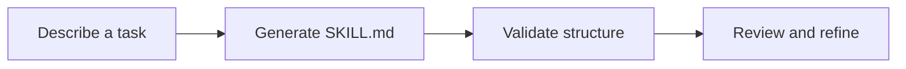

<div align="center">
  
  <h1>SkillForge</h1>
  <p><strong>Turn knowledge into reusable AI skills.</strong></p>
  <p>Create, validate, and manage portable <code>SKILL.md</code> packages for AI coding agents.</p>
  <p>
    
    
    
    
  </p>
</div>

---

SkillForge is a small, open-source developer tool for turning a repeatable task into a structured skill that an AI agent can follow. It gives you a consistent starting point, basic metadata validation, and a command-line workflow you can use locally or in CI.

The first release is intentionally **offline-first and template-based**. You do not need an API key to create or validate a skill. Repository ingestion, PDF parsing, and model-powered analysis are planned extensions; they are not represented as shipped features yet.

## Why SkillForge?

Agent instructions often begin as notes in a README, a team runbook, or someone's memory. SkillForge helps package those instructions as files that are easy to inspect, share, validate, and improve in version control.

- **Create a useful starting point** for a new skill in one command.
- **Validate the structure** before you share a skill with your team.
- **Use it in automation** from a terminal or a GitHub Actions workflow.
- **Stay in control** — generated files are plain Markdown, and validation never executes their contents.
- **Keep the tool lightweight** with no runtime dependencies in the current MVP.

## Quick start

### 1. Install from a local checkout

```bash
git clone https://github.com/piyush2707/skillforge.git
cd skillforge
python -m venv .venv
# macOS/Linux
source .venv/bin/activate
# Windows PowerShell: .venv\Scripts\Activate.ps1
python -m pip install -e .
```

> SkillForge is in early development. Until a package release is published, install it from source using the commands above.

### 2. Create your first skill

```bash
skillforge create "React Component Review" \
  --description "Review React components for accessibility, maintainability, and performance." \
  --output ./skills
```

This creates a small package like:

```text
skills/
└── react-component-review/
    ├── SKILL.md
    └── README.md
```

### 3. Validate it

```bash
skillforge validate ./skills/react-component-review
```

### 4. Run the structural test command

```bash
skillforge test ./skills/react-component-review
```

At this stage, `test` is a structural check—not a benchmark of how well a particular model follows the instructions.

## Commands

| Command | Purpose |
| --- | --- |
| `skillforge --version` | Show the installed version |
| `skillforge create NAME -d DESCRIPTION` | Generate a starter skill package |
| `skillforge validate PATH` | Validate a `SKILL.md` file or containing directory |
| `skillforge test PATH` | Run the same structural checks through the test command |

`create` also accepts `--output` / `-o` to select a destination folder and `--source` to preserve a short note about the source material.

## What does a skill look like?

Each generated `SKILL.md` contains YAML frontmatter and human-editable instructions. The metadata helps identify the skill; the body describes when it should be used and how to carry out the task.

```markdown
---
name: api-review
description: "Review API changes for correctness and consistency."
---

# API Review

## Purpose
Review API changes for correctness and consistency.

## Workflow
1. Understand the intended behavior and constraints.
2. Inspect the relevant endpoints, schemas, and tests.
3. Check error handling, compatibility, and edge cases.
4. Run relevant checks and summarize findings.
```

When writing your own skill, keep the `name` value lowercase, use numbers and hyphens where needed, and make the description explain both what the skill does and when it applies. The generated file includes a starter workflow that you should adapt to your task.

## How it works



1. **Describe** the skill you want and the situation where it should be used.
2. **Generate** a package containing `SKILL.md` and a short package README.
3. **Validate** metadata and the instruction body locally.
4. **Review and refine** the plain-text instructions before using them with an agent.

See [`docs/ARCHITECTURE.md`](docs/ARCHITECTURE.md) for the current design and implementation boundaries.

## Development

```bash
python -m venv .venv
source .venv/bin/activate  # Windows: .venv\Scripts\Activate.ps1
python -m pip install -e '.[dev]'
pytest
ruff check src tests
```

The GitHub Actions workflow is configured to run tests and Ruff linting on Python 3.10–3.13. This matrix will be verified by GitHub after the repository is published.

## Roadmap

- [x] Offline CLI for creating skill packages
- [x] Basic `SKILL.md` validation
- [x] Automated tests and CI workflow
- [ ] Import text and documentation files as source material
- [ ] Optional LLM provider for assisted skill drafting
- [ ] Task-level evaluation fixtures and reproducible skill benchmarks
- [ ] Explicit compatibility checks for additional agent environments
- [ ] Optional registry and version management

Roadmap items are intentions, not commitments; feature requests and contributions are welcome.

## Safety notes

A skill is a set of instructions, and skills sourced from the internet should be treated as untrusted input. Read generated files before installing them in an agent that can run shell commands, access private files, or call external services. SkillForge's validator only reads text and checks structure; it does not execute code from a skill.

For more details, see [`SECURITY.md`](SECURITY.md).

## Contributing

Bug reports, tests, documentation fixes, and focused feature proposals are welcome. Please read [`CONTRIBUTING.md`](CONTRIBUTING.md) before opening a pull request. For project conduct, see [`CODE_OF_CONDUCT.md`](CODE_OF_CONDUCT.md).

## License

SkillForge is released under the MIT License. See [`LICENSE`](LICENSE).

---

<div align="center">
  <sub>Built for developers who want their AI workflows to be reusable, reviewable, and easier to share.</sub>
</div>
